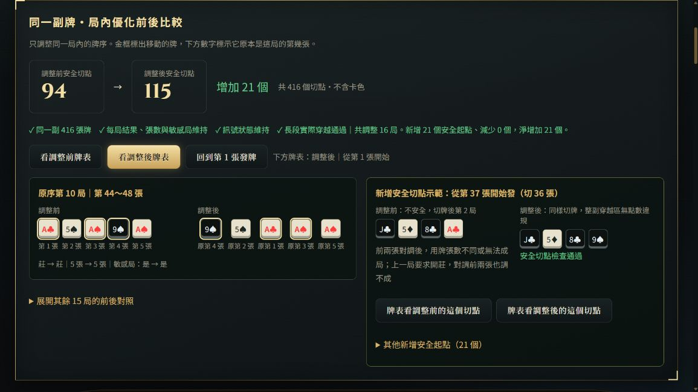

# 局內優化：同一副牌前後對照

主頁按「看一副示範」，排好後按「局內優化」。兩個版本會保留，可以來回切換；不重新洗牌，不跨局換牌，卡色不納入優化目標。

## 這次實際示範

- 同一副 416 張、零剩牌：安全切點 **94 → 115，增加 21 個**。
- 調整 16 局；新增 21 個安全起點，原有切點沒有減少。
- 每局的莊／閒／和結果、用牌張數、點數集合、敏感性維持；因此 A／2 和三條狀態不變。
- 各長段實際穿越重新驗證；末張仍為 9；原序莊閒差距不變。
- 卡色隨牌移動，按使用者要求留待事後處理。

先看畫面左邊原序第 10 局：

| | 牌序 | 結果 | 張數 | 敏感局 |
|---|---|---|---:|---|
| 調整前 | A♣、5♠、A♠、9♠、A♠ | 莊 | 5 | 是 |
| 調整後 | 9♠、5♠、A♣、A♠、A♠ | 莊 | 5 | 是 |

9♠ 從第 4 張移到第 1 張，A♣ 從第 1 張移到第 3 張，原第 3 張 A♠ 移到第 4 張。所有牌仍在同一局。

右邊示範從第 37 張開始（切 36 張）：調整前，切牌後第 2 局的前兩張無法在相同張數下對調成所需結果；調整後，按目前點數規則檢查整副穿越區沒有違規。兩個按鈕可直接把下方牌表切到相同位置比較。

## 為什麼不是先前提到的 104 → 132

實際切牌畫面暴露舊判定的漏洞：只排除「結果不變的莊／閒」，漏掉「和變莊／閒、莊／閒變和」。例如點數 9、0、6、5、0 對調前兩張，原本和變成閒，都是 5 張，但不是敏感局。

已同步修正主頁、批次和優化計數器，依原本定義只接受莊↔閒或和→和。**沒有重新加入任何「單局反向後整段還須穿越」的額外檢查。** 舊研究數字保留作歷史，不能作現行成效；本頁 94 → 115 是修正後重新實跑的結果。

## 實作及驗證

- 新模組：`traverse_optimizer.js`。最多四輪逐局搜尋；每次採用前確認局結果／張數／敏感性和長段實際穿越，只有安全點數增加才採用。沒有增加就保留原牌，停止時保留已驗證的結果。
- 只在同局排列實體牌，不重新從牌池分配牌面；輸入結果不被修改，前後版本能還原同一批牌。
- 主頁切牌、牌表、長段驗收、導出來源會隨前／後版本一起切換；手動換牌或更改規則後清除舊比較，避免拿舊數字代表新牌。
- 示範用真實引擎種子 1139，先選第一個安全末張 9 切點旋轉；不是假造最終結果。旋轉後搜尋順序及末張 9 保留條件，使示範結果與未旋轉的研究牌不同。
- 修正後四副原序樣本：100→110、94→117、96→105、97→106。這些是固定樣本，沒有保證所有牌都會增加。
- `node scripts/test-traverse-optimizer.cjs`：11 項通過，含逐切點對照原批次及所有標安全位置的敏感性驗證、和↔閒回歸、牌張守恆、輸入不變、跨頭尾長段、停止、剩牌、末張 9、主頁切換。
- 既有 `test-traverse-retry-policy.cjs` 17 項及 `test-traverse-process.cjs` 通過；既有重跑政策未變。
- 瀏覽器實際點擊示範／優化／前後切換／切點比較，結果一致，頁面錯誤 0，1164px 視窗無水平溢出。
- 保存完整前後牌及逐局異動：`optimizer-demo-2026-10-08.json`；截圖：同名 `.jpg`。

沒有導出或上傳測試牌；右側示範分頁可留著比較，關閉只會結束這次頁面狀態，仍可按「看一副示範」重現。
